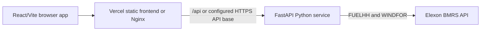

# Gridbricks Wind Intelligence

Gridbricks Wind Intelligence is a focused React and FastAPI application for evaluating
UK national wind-generation forecasts against Elexon BMRS observations for January 2026.
It makes forecast accuracy, alternative forecast vintages, and source-to-analysis
provenance inspectable without replacing missing observations with fabricated values.

## Live application

- Frontend: <https://gridbricks-wind-frontend.vercel.app>
- Backend API: <https://gridbricks-wind-backend.vercel.app>

These are the project’s configured deployment endpoints.

## Problem and capabilities

The project addresses a practical question: how closely did a selected day-ahead wind
forecast match observed national wind generation, and what forecast information was
available when that forecast was selected?

The application provides:

- Overview and accuracy KPIs.
- Actual-versus-forecast time series and error charts.
- MAE, RMSE, MBE, median absolute error, maximum absolute error, matched count, and coverage.
- Forecast Vintage Inspector with cutoff eligibility and selection reasons.
- Data Provenance view with raw records, normalized values, UTC mapping, and source IDs.
- Explicit loading, empty, partial-data, and live-data failure states.

## Screenshots

Repository screenshots are available in [`docs/`](docs/):

- [Overview](docs/manual-overview.png)
- [Accuracy Dashboard](docs/manual-accuracy.png)
- [Forecast Vintage Inspector](docs/manual-vintages.png)
- [Data Provenance](docs/manual-provenance.png)

## Architecture



The Vercel deployment uses separate frontend and backend projects. Docker Compose keeps
the frontend and backend together locally, with Nginx proxying `/api/` to the backend
container.

## Technology stack

- Frontend: React 18, TypeScript, Vite, Tailwind CSS, Recharts, Axios.
- Backend: Python 3.12 for Vercel, FastAPI, Pydantic Settings, HTTPX, NumPy.
- Local/container orchestration: Docker Compose and Nginx.
- Validation: pytest, pytest-asyncio, pytest-httpx, Ruff, Vitest, Testing Library, TypeScript.

## Repository structure

```text
backend/
  app/
    api/             FastAPI routes
    analytics/       Accuracy calculations
    clients/         Elexon HTTP client
    core/            Settings
    services/        Loading, matching, selection, provenance
    schemas/         API and source models
  main.py            Vercel forwarding entrypoint
  requirements.txt   Runtime dependencies
  requirements-dev.txt
frontend/
  src/api/           Centralized API client
  src/pages/         Dashboard pages
docs/                Methodology, validation, deployment, and submission material
```

## Data sources and scope

The application is intentionally limited to two public Elexon BMRS datasets:

- `FUELHH`, filtered to `fuelType=WIND`, for actual generation.
- `WINDFOR`, for forecast vintages and publication timestamps.

The evaluation period is **2026-01-01 through 2026-01-31**. Settlement periods are
one-indexed and mapped to UTC half-hour delivery intervals.

## Methodology

For each delivery interval, publication and delivery timestamps are normalized to UTC.
The selected forecast is the latest forecast published at or before the configurable
project evaluation policy of **D-1 09:00 UTC**. This is a project assumption defining an
information boundary for comparison; it is not an official or universal UK procurement
deadline and does not claim to reproduce every participant's information state.

Forecasts published after the cutoff cannot be selected. Missing values remain `null` and
are excluded from metrics. Zero is a valid generation value. Duplicate records are handled
deterministically. See [DATA_METHODOLOGY.md](docs/DATA_METHODOLOGY.md).

## Accuracy metrics

All metrics use the same deduplicated matched forecast/actual sample:

- **MAE:** mean absolute error, in MW.
- **RMSE:** root mean squared error, in MW.
- **MBE:** mean bias error, `forecast - actual`; positive means over-forecasting.
- **Median absolute error:** median of absolute errors, in MW.
- **Maximum absolute error:** largest absolute error, in MW.
- **Matched intervals:** valid forecast/actual pairs used by the metrics.
- **Coverage:** valid matched intervals divided by expected January intervals.

The documented January 2026 live validation reports:

| Metric | Value |
|---|---:|
| MAE | 2,145.17 MW |
| RMSE | 2,615.81 MW |
| MBE | +1,851.90 MW |
| Median absolute error | 1,795.50 MW |
| Maximum absolute error | 6,894 MW |
| Matched intervals | 1,488 / 1,488 |
| Coverage | 100.0% |

These are documented validation results, not guaranteed current values after a future
live-data refresh. See [JANUARY_2026_DATA_VALIDATION.md](docs/JANUARY_2026_DATA_VALIDATION.md).

## Local development

### Backend

```bash
cd backend
python3.12 -m venv .venv
.venv/bin/pip install -r requirements-dev.txt
.venv/bin/python -m pytest -q
.venv/bin/ruff check app tests main.py
.venv/bin/uvicorn app.main:app --reload --host 127.0.0.1 --port 8000
```

### Frontend

```bash
cd frontend
npm ci
npm test
npm run build
npm run dev
```

Vite proxies `/api` to `http://localhost:8000`. For another backend origin, set
`VITE_API_BASE_URL`; the client normalizes the value to exactly one `/api` suffix.

## Docker Compose

```bash
cp .env.example .env
docker compose config --quiet
docker compose build --no-cache
docker compose up -d
curl -fsS http://localhost:8080/api/health
curl -fsS http://localhost:8080/api/metadata
docker compose ps
docker compose down
```

Fixture mode defaults to false. Enable it only explicitly for offline development; it
must remain false for live validation and production.

## Vercel deployment

Deploy two projects from the same repository:

1. Backend root `backend/`, Python 3.12, entrypoint `main.py`.
2. Frontend root `frontend/`, build command `npm run build`, output `dist`.

Backend environment variables:

```text
GRIDBRICKS_USE_FIXTURES=false
GRIDBRICKS_ELEXON_BASE_URL=https://data.elexon.co.uk/bmrs/api/v1
GRIDBRICKS_ELEXON_TIMEOUT_SECONDS=20
GRIDBRICKS_ELEXON_MAX_RETRIES=1
GRIDBRICKS_CORS_ORIGINS=https://<frontend-domain>
```

Frontend build-time variable:

```text
VITE_API_BASE_URL=https://<backend-domain>
```

The centralized client adds `/api` exactly once. See [DEPLOYMENT.md](docs/DEPLOYMENT.md)
and [DEPLOYMENT_READINESS.md](docs/DEPLOYMENT_READINESS.md).

## API reference

All analytical routes use `GET`:

| Endpoint | Purpose |
|---|---|
| `/api/health` | Health and version |
| `/api/metadata` | Sources, period, cutoff policy, mode |
| `/api/analysis/overview` | Overview KPIs |
| `/api/analysis/series` | Forecast/actual series with date filters |
| `/api/analysis/accuracy` | Accuracy metrics and breakdowns |
| `/api/analysis/vintages` | Bounded vintage inspection with pagination |
| `/api/analysis/provenance` | Bounded source-to-analysis records |

## Limitations and assumptions

- The product covers January 2026 UK national wind only.
- The D-1 09:00 UTC boundary is configurable project evaluation policy.
- Data and cache are in memory; serverless instances are independent and reload on cold start.
- No persistent database, durable historical extract, or portfolio optimization is included.
- Elexon failures with fixtures disabled produce explicit error state, not mock results.
- Browser E2E coverage and public uptime monitoring are not included.

## AI tools disclosure

AI coding tools were used to inspect the repository, implement and refine code/tests,
investigate deployment packaging, and draft documentation. Validation commands and live
data claims were checked against local source and executed results. No AI-generated mock
data is used in the production data flow.

## License

No license file or license selection is currently present. Add a license before public
reuse if the project owner intends to grant reuse rights.
