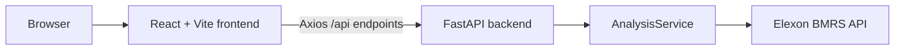

# Architecture

## System overview

Gridbricks is a two-part application:

The frontend is a static Vite bundle. The backend owns all data ingestion, normalization,
forecast selection, analytics, API schemas, and explicit error behavior.

## Runtime layouts

### Docker Compose

- `frontend` builds React and serves it with Nginx.
- Nginx proxies `/api/` to the `backend` service.
- `backend` runs Uvicorn on port 8000.
- The backend is not published directly to the host by Compose.

### Vercel

- Frontend and backend are separate Vercel projects.
- The frontend is built with `VITE_API_BASE_URL`.
- The backend is a Python 3.12 Function using root `backend/main.py`.
- The browser calls the backend's HTTPS `/api/...` routes directly.

## Backend components

- `app/main.py`: FastAPI app creation, CORS, route registration, and lifespan preload.
- `app/api/routes.py`: health, metadata, analysis, vintage, and provenance endpoints.
- `app/clients/elexon_client.py`: HTTP requests, timeout/retry behavior, and source mapping.
- `app/services/analysis_service.py`: cache, loading, concurrent dataset fetch, matching, and
  cross-feature data access.
- `app/services/forecast_selector.py`: UTC delivery interval and latest-eligible-vintage logic.
- `app/analytics/accuracy.py`: shared matched-sample metric calculations.
- `app/schemas/`: Pydantic models for source and API contracts.

## Frontend components

- `src/api/client.ts`: one centralized Axios client and API-base normalization.
- `src/pages/`: overview, accuracy, series, vintage, and provenance views.
- `src/components/`: shared layout and dashboard components.
- Vite provides local `/api` proxying; production uses the configured backend origin.

## Data flow

1. FastAPI lifespan initializes `AnalysisService`.
2. The service fetches FUELHH and WINDFOR concurrently.
3. Records are validated and timestamps are normalized to UTC.
4. Actuals map settlement date/period to half-hour delivery intervals.
5. Forecasts are grouped by delivery interval.
6. The latest publication at or before the cutoff is selected.
7. Accuracy, vintage, and provenance views read the same in-memory analysis state.

Live failure with fixtures disabled clears partial state and exposes an explicit error mode.
There is no implicit fixture fallback.

## Serverless limitations

The cache and lock are process-local. Multiple Vercel instances do not share memory, so a
cold instance may preload independently. Restarting a process reloads from Elexon. No
database, Redis layer, or durable extract is used.
